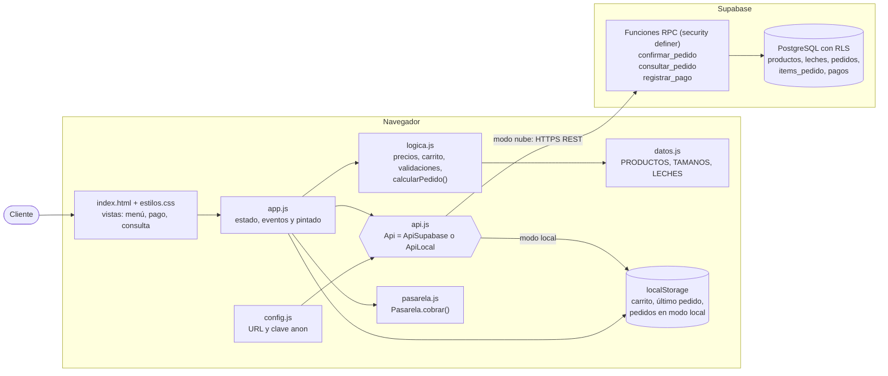
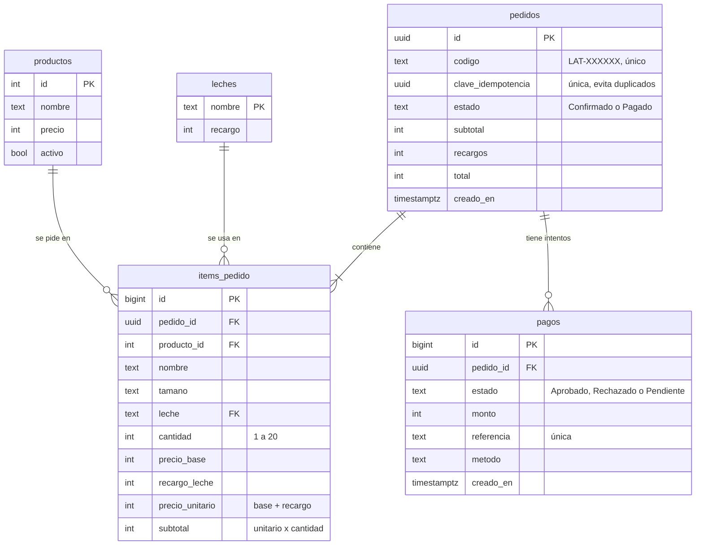
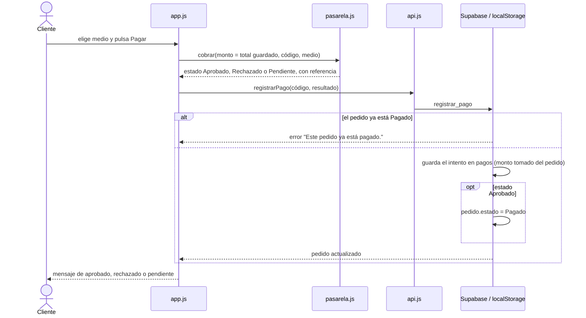
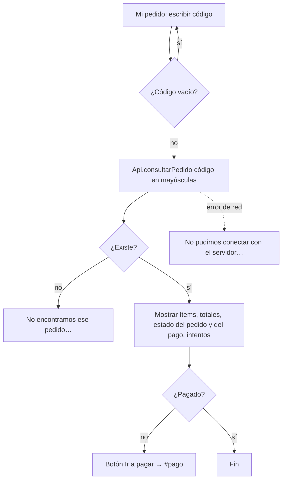

# Arquitectura y flujos – Lattely

Los diagramas describen el código que hay en este repositorio. Están en Mermaid, así que GitHub los dibuja solos.

## 1. Vista general

Lattely es una página web estática, sin servidor propio ni paso de compilación. Puede guardar los pedidos de dos formas, y las dos usan la misma interfaz `Api`:

- **Modo local** (`ApiLocal`): guarda en `localStorage` del navegador. Se usa cuando `config.js` está vacío.
- **Modo nube** (`ApiSupabase`): llama a funciones RPC de Supabase (PostgreSQL). Se usa cuando `config.js` tiene URL y clave `anon`.



| Archivo | Responsabilidad |
|---|---|
| `index.html` | Estructura de las tres vistas y de las ventanas (personalizar, resumen, privacidad) |
| `estilos.css` | Diseño y adaptación a celular |
| `datos.js` | Catálogo: productos, precios, tamaños, recargos de leche e imágenes |
| `logica.js` | Funciones puras sin acceso al DOM: precio unitario, carrito, totales, validación y `calcularPedido()`. Es lo que prueban las pruebas automáticas |
| `app.js` | Estado de la interfaz, acciones del usuario y navegación por `#menu`, `#pago` y `#consulta` |
| `api.js` | Persistencia de pedidos y pagos con la misma interfaz en los dos modos |
| `pasarela.js` | Pasarela de pagos. Para usar una pasarela real basta con cambiar `cobrar()` |
| `db/schema.sql` | Tablas, RLS, funciones RPC y datos de ejemplo de Supabase |

## 2. Modelo de datos (Supabase)



Seguridad: todas las tablas tienen RLS activado y se revocan los permisos directos. La clave `anon` solo puede ejecutar las tres funciones RPC. Los precios se recalculan en el servidor y la tabla `pagos` no tiene columnas para datos de tarjeta. Las columnas exactas están en `db/schema.sql`.

## 3. Flujo: armar y confirmar el pedido

```mermaid
sequenceDiagram
  actor C as Cliente
  participant A as app.js
  participant L as logica.js
  participant API as api.js
  participant S as Supabase / localStorage

  C->>A: + Agregar, tamaño, leche
  A->>L: agregarItem(carrito, producto, tamaño, leche)
  L-->>A: error si falta tamaño, o ítem agregado
  A->>A: guarda carrito en localStorage y repinta totales
  C->>A: Confirmar pedido
  A->>L: validarCarrito(carrito)
  A-->>C: resumen con subtotal, recargos y total
  C->>A: Confirmar y pagar
  A->>A: deshabilita el botón y crea la clave UUID del carrito
  A->>API: confirmarPedido(producto, tamaño, leche y cantidad; clave)
  API->>S: confirmar_pedido (recalcula precios desde las tablas)
  alt la clave ya existe (doble clic o reintento)
    S-->>API: el mismo pedido de antes
  else clave nueva
    S-->>API: pedido nuevo LAT-XXXXXX, estado Confirmado
  end
  API-->>A: pedido
  A->>A: vacía el carrito, guarda el último código y va a #pago
```

## 4. Flujo: pago



## 5. Flujo: consulta



## 6. Limitaciones conocidas
- La pasarela no está conectada a un banco: el medio elegido define el resultado. Con una pasarela real, el resultado lo tendría que confirmar el servidor (webhook) y no el navegador.
- En modo local los pedidos solo existen en el navegador donde se hicieron.
- No hay cuentas de usuario: quien conozca el código de un pedido puede consultarlo.
